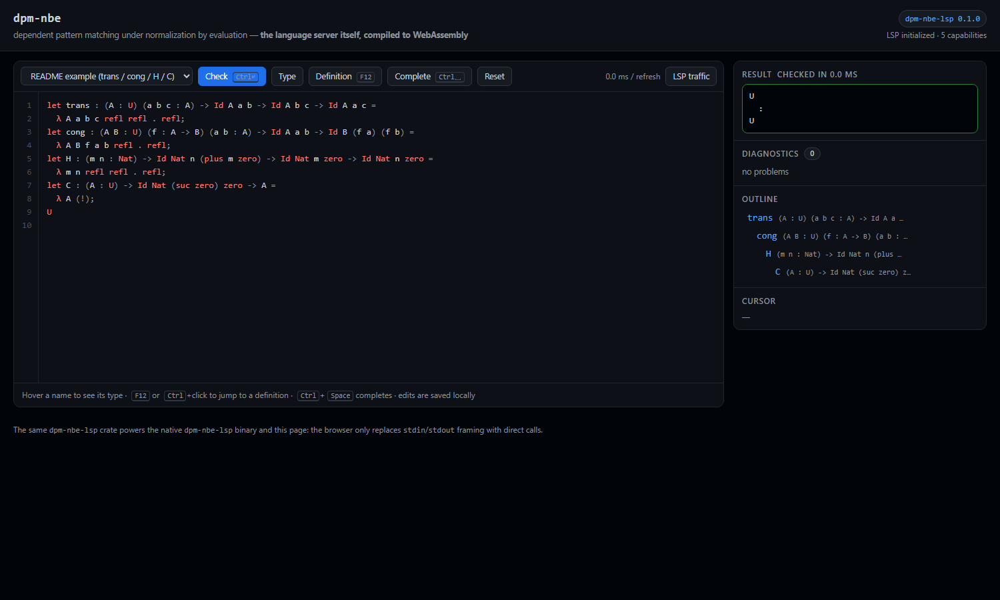
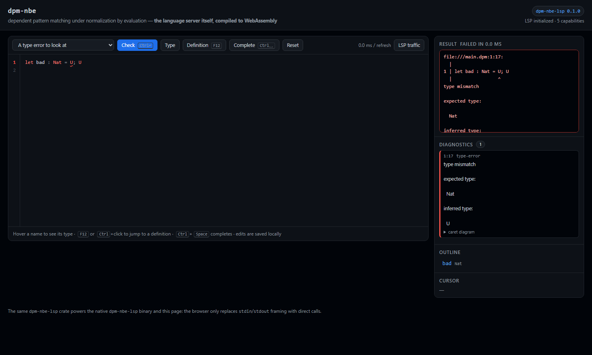

# dpm-nbe web IDE — the language server in the browser

> 摘要：把同一份 `dpm-nbe-lsp` 编译成 WebAssembly，在浏览器里跑一个真正的
> 语言服务器：编辑区的高亮、下划线诊断、悬停类型、补全、跳转定义、大纲，
> 全部来自标准 JSON-RPC / LSP 对话（`web/www` 里有一个 “LSP traffic” 面板，
> 能直接看到它们）。零框架、零构建步骤、零 npm 依赖。

## What this is

The page in `web/www` is a small IDE for `.dpm` files.  It is *not* a second
implementation of the language: `web/api/dpm-nbe-wasm` is a `wasm-bindgen`
binding over the crate in [`../lsp/`](../lsp/README.md), and the frontend is an
LSP client that talks to it with the same messages an editor would send over a
pipe.  The contract between the two is [api/CONTRACT.md](api/CONTRACT.md).

Features, all of them protocol round trips:

| In the page | Protocol |
| --- | --- |
| squiggles, gutter markers, diagnostics list | `textDocument/didOpen` + `didChange` → `textDocument/publishDiagnostics` |
| syntax highlighting | `dpm-nbe/tokens` |
| hover card with the binder's type | `textDocument/hover` |
| completion popup (`Ctrl`+`Space`, or while typing) | `textDocument/completion` |
| “Definition” button, `F12`, `Ctrl`+click | `textDocument/definition` |
| outline panel | `textDocument/documentSymbol` |
| “Check” / “Type” panels | `dpm-nbe/evaluate` |
| the “LSP traffic” panel | every message in both directions |

## Build and run

```sh
# prerequisites: rustup target add wasm32-unknown-unknown
#                wasm-bindgen CLI, exactly the version pinned in
#                web/api/dpm-nbe-wasm/Cargo.toml (=0.2.128)

node web/build.mjs          # cargo build + wasm-bindgen -> web/www/pkg/
node web/build.mjs --debug  # faster rebuild, bigger module
node web/serve.mjs          # http://127.0.0.1:8140
```

`application/wasm` is required, hence a server: opening `index.html` from
`file://` cannot work.  `serve.mjs` is 60 lines of `node:http` with no
dependencies.

## Tests

```sh
node web/tools/smoke.mjs         # 38 checks: the wasm server, end to end
node web/tools/client-smoke.mjs  # 29 checks: web/www/lsp.js against that server
```

Neither needs a browser.  `smoke.mjs` loads the generated glue in Node with the
wasm bytes read from disk and drives a full conversation — handshake, a type
error with its exact position, hover, completion, definition, outline,
evaluation, tokens — and checks that pathological input (2000 nested
parentheses, 150 nested constructors) comes back as a diagnostic instead of a
trap.  `client-smoke.mjs` covers the half of the frontend that faces the server,
including concurrent requests and the dead-session guard rails.

The DOM half is exercised by serving the page and driving a headless Chromium:

```sh
node web/serve.mjs &
chrome --headless=new --virtual-time-budget=8000 --dump-dom http://127.0.0.1:8140/?preset=broken
# the dumped DOM must contain the type error, one gutter marker and the token spans
```

## Deploy to GitHub Pages

`.github/workflows/pages.yml` builds the module and publishes `web/www`:

* trigger: a push to `main` that touches `web/`, `lsp/`, `src/`, `Cargo.toml`,
  `Cargo.lock` or the workflow itself (and manual `workflow_dispatch`),
* steps: install `wasm-bindgen` 0.2.128 → `node web/build.mjs` →
  `node web/tools/smoke.mjs` + `node web/tools/client-smoke.mjs` (the deploy is
  gated on the module passing its own tests) → `actions/upload-pages-artifact`
  on `web/www` → `actions/deploy-pages`.

One-time setup: **Settings → Pages → Source = “GitHub Actions”**.  The workflow
passes `enablement: true` to `actions/configure-pages`, so the first run can also
turn Pages on by itself.  Nothing in the page is absolute-path based, so it works
both at `https://<user>.github.io/dpm-nbe-rs/` and on a custom domain.

## Screenshots

`docs/ide-readme.png` — the README proofs: syntax highlighting from
`dpm-nbe/tokens`, the nested outline from `textDocument/documentSymbol`, and the
program's normal form and type from `dpm-nbe/evaluate`.



`docs/ide-diagnostics.png` — a deliberate type error: the squiggle and the gutter
marker come from `textDocument/publishDiagnostics`, and the context panel shows
the CLI's own caret diagram (`file:///main.dpm:1:17`, `^` under the `U`).



## Layout

```
web/
  api/CONTRACT.md              the JS <-> wasm contract (read this first)
  api/dpm-nbe-wasm/            cdylib crate: LspSession, check(), info()
  www/index.html               the IDE shell
  www/style.css                one stylesheet, GitHub-ish dark theme
  www/app.js                   wiring: presets, panels, storage, shortcuts
  www/lsp.js                   the LSP client (no DOM: tested in Node)
  www/editor.js                textarea + highlight mirror + popups
  www/pkg/                     generated (git-ignored)
  build.mjs                    cargo + wasm-bindgen
  serve.mjs                    zero-dependency static server
  tools/smoke.mjs              server-side integration test
  tools/client-smoke.mjs       client-side integration test
```

## Using the page

* **Examples** — the dropdown is a set of small programs (the README proofs, an
  arithmetic normalisation, a dependent type, an absurd pattern, a deliberate
  type error, and a 150-deep numeral).
* **Editing** — edits are stored in `localStorage` and restored on reload;
  `Reset` throws the local copy away and restores the example.
* **Hover** — move the caret (or click) on a name; the card shows the type the
  syntax gives that binder, or the keyword's documentation.
* **Definition** — `F12`, the toolbar button, or `Ctrl`+click.
* **Completion** — `Ctrl`+`Space`, or just keep typing an identifier.  `↑`/`↓`,
  `Enter`/`Tab`, `Esc`; each entry shows its type.
* **Check** — `Ctrl`+`Enter` or the button; `Type` shows only the type.  A red
  panel is a parse/type error (`ok:false`, language level); an amber banner is a
  wasm trap (a Rust panic cannot unwind on `wasm32-unknown-unknown`) and needs a
  page reload.
* **Deep links** — `?preset=broken` selects an example directly.

## Troubleshooting

| Symptom | What to do |
| --- | --- |
| “wasm not built” banner, 404 in the console | `node web/build.mjs`, then reload. |
| Blank page | Serve over HTTP (`node web/serve.mjs`); `file://` cannot load the module. |
| Amber “instance crashed” banner | Reload the page. If it reproduces, the input is reaching a panic path — that is a bug worth reporting with the program text. |
| `wasm-bindgen` version error | The CLI must be exactly the version pinned in `web/api/dpm-nbe-wasm/Cargo.toml`. |
| Completion popup does not appear | `Ctrl`+`Space` always asks the server; automatic completion only starts after an identifier character. |
